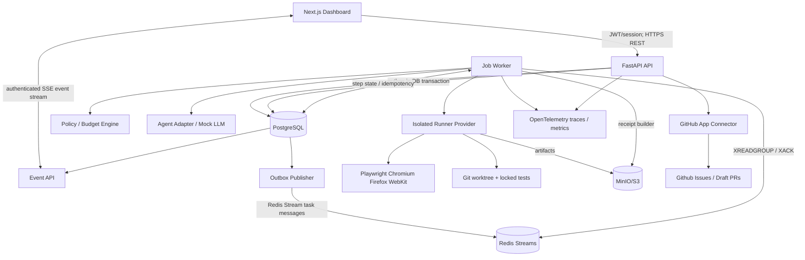

# Architecture and implementation contracts

Version 1.0 — proposed design, subject to Phase 0 repo audit. These are **target interfaces**, not assertions about code that exists.

## 1. Architecture: modular control plane + isolated workers



**Boundary 1: Control plane.** Auth, plans, policies, jobs, state, approvals, receipts, GitHub write actions. Hosts NO untrusted generated project code.

**Boundary 2: Worker process.** Handles workflow state and agent prompts. Not allowed to grant itself new permissions; invokes runner through authenticated capability-scoped API. No arbitrary host shell execution.

**Boundary 3: Untrusted execution plane.** Ephemeral runner on separate isolated Linux host/VM or a dedicated hardened sandbox provider. Contains project source, test frameworks and temporary outputs. Does not contain API/DB/GitHub/cloud credentials. Minimal outbound network.

**Boundary 4: Object store.** Private evidence artifacts: generated output, logs, traces, screenshots, patches, receipt. Every object is authorized and content-hashed; serve only short-lived signed reads.

**Boundary 5: External integrations.** Only control plane calls GitHub's remote write API after explicit approved action; never from sandbox.

## 2. Why not 8 microservices

The workload has a natural separation between control plane and untrusted runner. Keep core auth, policy, repository metadata, events and API within one FastAPI application split into modules. Operate separately deployable worker(s) for long-running jobs. Extraction into services only follows measured operational need and an ADR. This minimizes failure modes while giving real concurrency/distributed systems depth.

## 3. Recommended repository layout

```text
buildverify/
├── AGENTS.md
├── README.md
├── apps/
│   ├── web/                       # Next.js TypeScript frontend
│   └── api/                       # FastAPI app with domain modules
│       ├── app/api/v1/
│       ├── app/auth/
│       ├── app/domain/{jobs,plans,policies,repos,receipts}/
│       ├── app/services/{github,artifacts,models}/
│       ├── app/infrastructure/{db,redis,otel}/
│       ├── alembic/
│       └── tests/
├── services/
│   ├── orchestrator-worker/       # task/step dispatch, leases, heartbeats
│   └── runner-gateway/            # provider abstraction; hardened runner host
├── packages/
│   ├── contracts/                 # OpenAPI-generated client + shared schemas
│   └── sample-fixtures/           # deliberately broken example apps, oracle tests
├── infra/
│   ├── compose/                   # local trusted-mode orchestration
│   ├── runner/                    # isolated host security policy
│   └── ci/                        # CI workflows and smoke configs
├── tests/
│   ├── contract/
│   ├── integration/
│   ├── e2e/
│   ├── chaos/
│   └── security/
├── benchmarks/
│   ├── fixtures/
│   ├── manifests/
│   └── reports/
├── docs/
│   ├── adr/
│   ├── REPO_AUDIT.md
│   └── IMPLEMENTATION_STATUS.md
└── Makefile / package manager files
```

If the actual repo has a different layout, adapt without gratuitous migration.

## 4. Workflow state machine

### Job states
`CREATED -> PLANNING -> AWAITING_PLAN_APPROVAL -> QUEUED -> REPRODUCING -> PATCHING -> REVIEWING -> TESTING -> ASSEMBLING_RECEIPT -> AWAITING_PR_APPROVAL -> COMPLETED`

Allowed alternative terminal states: `FAILED`, `CANCELLED`, `BUDGET_EXHAUSTED`, `POLICY_BLOCKED`, `INCONCLUSIVE`, `COMPLETED_WITH_WARNINGS`. Any active state can transition to `CANCELLING` then `CANCELLED` when safe cleanup completes. Timeout is explicit `FAILED` with reason code `TIMEOUT` or `INCONCLUSIVE` when environment evidence is insufficient. Terminal transitions recorded in append-only events.

### Step states
`PENDING -> CLAIMED -> RUNNING -> SUCCEEDED|RETRY_WAIT|FAILED|CANCELLED|SKIPPED`

On lease expiry `CLAIMED/RUNNING -> RETRY_WAIT` with an attempt increment and new owner. `RUNNING` is never automatically turned `SUCCEEDED` because an agent said so; require expected external evidence and persisted result. Stale attempts may finish late: protect with `attempt_id`, lease fencing token and compare-and-swap (CAS) updates.

### Verification statuses
- `VERIFIED`: reproduction confirmed against locked oracle on base; patched code passes locked oracle and required suite; policy gates pass; all required matrix checks pass.
- `PARTIALLY_VERIFIED`: patch passes some required checks but others skipped or unsupported; explicit warnings.
- `FAILED`: valid negative test or regression after patch.
- `INCONCLUSIVE`: no reproducible baseline, environment/infra problem, ambiguous oracle or missing evidence.
- `POLICY_BLOCKED`: prohibited action or unapproved scope.

Do not count `PARTIALLY_VERIFIED` as success in benchmarks.

## 5. Source of truth, delivery and retry semantics

**Source of truth = PostgreSQL.** Each user-visible job transition and outbox record written within one DB transaction. Outbox poller publishes event to Redis Stream and marks it published *idempotently*. Duplicate publish is acceptable because worker deduplicates by `job_id, step_id, logical_operation_key`.

**Redis Streams** provides at-least-once work distribution. Worker acquires `attempt_id` and job-step CAS lease in DB; executes allowed operation; writes step output, receipts/artifact references and outbox event transactionally; only then sends `XACK`. Reaper inspects idle pending entries (XAUTOCLAIM / depending on server version), honors lease expiry and bounded retries.

**Side effects:** GitHub branch creation/PR creation uses stable operation key `repo_id + base_sha + issue_id + approved_plan_hash + action_type`. Reconcile via GitHub API before retrying any uncertain remote write; GitHub may accept a request whose response was lost. Never assume exactly-once API effects.

**Backoff:** bounded exponential backoff with jitter for transient errors (e.g. attempt 1/2/3); no retry on policy denial, invalid schema or non-retryable auth issues. Retry policies stored per step type.

**Cancellation:** mark desired state, revoke worker lease safely, stop runner via control gateway, persist terminal reason. If remote PR already created, do not silently delete it; mark compensation/manual follow-up.

**Outbox retention:** event delivery ledger/offset plus event table; consumer uses monotonic `event_seq` per job to replay missed live events.

## 6. Proposed database schema (minimum fields)

| Table | Important fields and constraints |
|---|---|
| `users` | UUID id, provider_subject UNIQUE, email, created_at |
| `workspaces` | UUID id, owner_id FK, name, retention_policy JSON, timestamps |
| `workspace_members` | workspace_id, user_id, role CHECK, UNIQUE(workspace_id,user_id) |
| `repositories` | id, workspace_id, integration_id NULL, full_name, provider, installation_id, allowlisted, default_branch, last_seen_sha |
| `integrations` | id, workspace_id, provider, installation_id, secret_ref (never raw token), scopes, status |
| `jobs` | id UUID, workspace_id, repo_id, issue_ref NULL, base_sha, status, budget_tokens, budget_usd, actual_tokens, actual_cost, plan_hash, idempotency_key, created_by, version INT, created_at, updated_at; UNIQUE(workspace_id,idempotency_key) |
| `plans` | id, job_id UNIQUE, plan_json versioned, allowed_paths, risk_level, approval_required, SHA256 canonical plan hash, timestamps |
| `approvals` | id, job_id, action_type, actor_user_id, plan_hash, patch_hash, decision, reason, created_at; no overwrite |
| `steps` | id, job_id, kind, status, step_index, logical_key, lease_owner, lease_version, heartbeat_at, attempts, max_attempts, last_error_code; UNIQUE(job_id,logical_key) |
| `attempts` | id, step_id, worker_id, started_at, ended_at, status, error, trace_id, runtime_fingerprint, parent_attempt_id |
| `events` | id UUID, job_id, event_seq BIGINT, event_type, schema_version, payload JSONB, trace_id, occurred_at; UNIQUE(job_id,event_seq) |
| `outbox` | id, event_id UNIQUE, topic, payload JSONB, published_at NULL, created_at, retry_count |
| `artifacts` | id, workspace_id, job_id, attempt_id, kind, storage_key, sha256, bytes, content_type, redacted, expires_at |
| `test_runs` | id, job_id, attempt_id, base_or_patch, browser_project, suite_id, commit_sha, status, seed, duration_ms, evidence_manifest_id |
| `test_cases` | id, test_run_id, test_id, status, error_type, retry_count, artifact_refs JSONB |
| `patches` | id, job_id, base_sha, patch_sha256, target_sha NULL, diff_storage_ref, changed_paths, review_status |
| `receipts` | id, job_id UNIQUE, status, schema_version, receipt_sha256, receipt_storage_key, signed BOOL, signature_key_id NULL, created_at |
| `github_operations` | id, job_id, action, idempotency_key UNIQUE, remote_resource_id NULL, status, request_hash, response_hash |
| `usage_events` | id, job_id, step_id, model, provider, prompt_tokens, completion_tokens, estimated_cost_usd, duration_ms, call_id UNIQUE |

Required indexes: `(workspace_id, created_at DESC)` jobs; `(status, heartbeat_at)` steps; `(job_id, event_seq)` events; `(expires_at)` artifacts; `(job_id, created_at)` approvals; unique stable webhook delivery id in `webhook_deliveries`. Use `NUMERIC`/integer micros or fixed-point for currency, not float accumulation.

**Concurrency:** all step transitions guarded by `(id, version)` CAS or explicit row lock. Workspace authorization must be included in every repository/job/artifact lookup; do not query only by a guessed object UUID.

## 7. HTTP API (proposed v1)

| Verb | Endpoint | Access | Behavior / expected response |
|---|---|---|---|
| POST | `/api/v1/jobs` | maintainer+ | Create job; `Idempotency-Key`; 201 with job_id/status |
| GET | `/api/v1/jobs` | workspace member | Paginated list with status/date filters; scoped by workspace |
| GET | `/api/v1/jobs/{id}` | workspace member | Job, budget, current stage, latest event sequence |
| GET | `/api/v1/jobs/{id}/events?after_seq=N` | workspace member | Paginated replay with stable ordering |
| GET | `/api/v1/jobs/{id}/stream?after_seq=N` | workspace member | Authenticated SSE stream with cursor/heartbeat |
| POST | `/api/v1/jobs/{id}/approve-plan` | owner/maintainer | Body `{plan_hash, decision}`; optimistic locking |
| POST | `/api/v1/jobs/{id}/cancel` | owner/maintainer | Idempotent cancellation request |
| POST | `/api/v1/jobs/{id}/retry` | owner/maintainer | Only permitted failed/inconclusive step with reason |
| GET | `/api/v1/jobs/{id}/tests` | workspace member | Browser × case matrix and artifact IDs |
| GET | `/api/v1/jobs/{id}/patch` | workspace member | Diff metadata / authorized bounded preview |
| GET | `/api/v1/jobs/{id}/receipt` | workspace member | Receipt JSON + downloadable Markdown reference |
| GET | `/api/v1/artifacts/{id}/access` | workspace member | Short-lived signed read URL or proxied content |
| POST | `/api/v1/jobs/{id}/approve-pr` | owner/maintainer | Body `{plan_hash, patch_hash, repo_id, base_sha}` |
| POST | `/api/v1/integrations/github/install` | owner | Starts app installation/auth flow, CSRF protected |
| POST | `/api/v1/webhooks/github` | public signed webhook | HMAC verify + dedupe + enqueue; no LLM execution sync |
| GET | `/api/v1/health/live` | public | Process liveness only |
| GET | `/api/v1/health/ready` | internal | DB/Redis dependency readiness |

API contract requirements: OpenAPI spec checked into repo, typed TypeScript client generated, RFC7807-like structured errors (`code`, `message`, `request_id`, safe `details`), pagination cursor or stable offset, explicit versioning, 401/403/404 and rate limit behavior, request size limits and validation on every endpoint.

## 8. Example request and event payloads

```json
{
  "repository_id": "repo_uuid",
  "base_sha": "40hexsha1_or_provider_revision_id",
  "issue": {"title":"Checkout total broken", "body":"Reproduction steps..."},
  "mode": "bug_fix",
  "budget": {"max_model_tokens": 200000, "max_estimated_cost_usd": 3.00, "max_attempts": 2},
  "test_profile": "browser_matrix_basic",
  "policy_profile": "trusted_demo_fixture"
}
```

The example budget is an *illustrative configurable cap*, not a model pricing quote.

```json
{
  "event_id": "event_uuid",
  "schema_version": 1,
  "job_id": "job_uuid",
  "event_seq": 42,
  "type": "qa.test.completed",
  "occurred_at": "2026-11-22T10:00:00Z",
  "trace_id": "w3c_trace_id",
  "attempt_id": "attempt_uuid",
  "payload": {
    "stage": "patched_test",
    "browser": "firefox",
    "test_id": "checkout/discount.spec.ts::empty coupon",
    "status": "passed",
    "duration_ms": 912,
    "artifact_ids": ["trace_artifact_uuid"]
  }
}
```

Event naming: `job.created`, `job.status_changed`, `plan.proposed`, `approval.requested`, `approval.decided`, `agent.step_started`, `agent.tool_denied`, `patch.proposed`, `qa.test.started`, `qa.test.completed`, `qa.reproduction.confirmed`, `receipt.issued`, `github.pr.created`, `job.failed`. Never put secrets or raw private code into events by default.

## 9. Policy, agent and runner interfaces

**Agents:**
```python
class ModelAdapter(Protocol):
    async def generate_structured(self, *, context: dict, schema: type, budget: dict) -> dict: ...

class AgentStep(Protocol):
    async def run(self, context: "StepContext") -> "StepResult": ...

class ToolPolicy(Protocol):
    def authorize(self, actor: "Actor", action: "ToolAction", scope: "Scope") -> "Decision": ...
```

**Runner adapter:**
```python
class RunnerProvider(Protocol):
    async def create_workspace(self, *, job_id: str, base_sha: str, image_digest: str) -> str: ...
    async def run_command(self, *, workspace_id: str, argv: list[str], limits: dict) -> "ExecutionResult": ...
    async def collect_artifacts(self, *, workspace_id: str) -> list["ArtifactRef"]: ...
    async def cancel(self, *, workspace_id: str) -> None: ...
    async def destroy(self, *, workspace_id: str) -> None: ...
```

Commands must come from a trusted, explicit `test_profile` manifest or allowlist, **not arbitrary shell strings issued by an LLM**. The source code in the repository may still execute arbitrary code, so isolation remains mandatory. Never enable unsafe host command mode by default.

**Policy gates**:
- `READ_REPO`: scoped read, all branches subject to repository access.
- `WRITE_WORKTREE`: allowlisted project files only; deny `.github/workflows/**`, `.env*`, secret paths, Git config and oracle tests without exception.
- `RUN_TEST_PROFILE`: approved command registry; no shell interpolation; resource/network policy fixed by server.
- `INSTALL_DEPENDENCIES`: separate bootstrap approval, allowlisted registry/cache, package manager lifecycle script risk clearly disclosed.
- `PUSH_BRANCH` and `CREATE_PR`: explicit approval with plan/patch hash binding.
- `DEPLOY`, `MERGE_PR`, `DELETE_REPO`: not exposed at all in MVP/V1.

## 10. Reproduction and verification pipeline: exact evidence logic

1. `BASELINE`: checkout immutable base SHA, restore verified deps/runtime fingerprint, run *independent locked oracle* test, record failure signature. If no meaningful reproduction, status `INCONCLUSIVE`, optionally allow exploratory mode but not `VERIFIED` claim.
2. `PATCH`: agent may modify allowlisted application files in a separate workspace; patch hash computed from normalized diff and commit/base. Reject forbidden file changes.
3. `REVIEW`: static policy + reviewer verifies acceptance behavior / data changes; code modifications bounded; human approval for dependency/lockfile changes.
4. `PATCHED_TEST`: run same oracle tests unchanged; if tests still fail, bounded iterative repair.
5. `REGRESSION`: run existing unit/integration/browser suites; show skip reasons; compare to baseline when helpful.
6. `MATRIX`: test profile defines browsers/OS/backend; local engines labelled accurately.
7. `RECEIPT`: deterministic renderer uses machine result artifacts; LLM commentary is optional and clearly marked advisory.
8. `PR`: submit diff and receipt only after approval; branch push via control plane, annotate incomplete checks.

**Anti-test-cheating:** any oracle test or config modification makes `VERIFIED` impossible unless change is reviewed by an independent human and revalidated against an externally controlled oracle. Optionally mount oracle tests read-only from orchestrator fixture separate from agent's worktree.

## 11. Verification Receipt schema (v1)

```json
{
  "schema_version": "1.0",
  "receipt_id": "uuid",
  "job_id": "uuid",
  "status": "VERIFIED",
  "repository": {"provider": "github", "repo": "owner/name", "base_sha": "...", "patched_sha": "..."},
  "scope": {"approved_plan_sha256": "...", "changed_paths": ["src/cart.ts"], "diff_sha256": "..."},
  "environment": {"runner_provider":"isolated-vm", "image_digest":"sha256:...", "lockfile_sha256": "...", "tool_versions":{}, "browser_versions":{}},
  "proof": {
    "baseline": [{"case_id":"...", "status":"FAILED", "failure_signature":"...", "artifact_ids":[]}],
    "patched": [{"case_id":"...", "status":"PASSED", "artifact_ids":[]}],
    "regressions": [{"suite":"...", "status":"PASSED"}],
    "skipped_checks": [],
    "risk_warnings": []
  },
  "usage": {"input_tokens":0, "output_tokens":0, "estimated_cost_usd":"0.00", "wall_time_ms":0},
  "approvals": [{"actor_id":"...", "action":"CREATE_PR", "decision":"APPROVED", "bound_patch_sha256":"..."}],
  "artifacts": [{"kind":"trace", "sha256":"...", "object_key":"..."}],
  "issued_at":"2026-11-22T10:00:00Z",
  "manifest_sha256":"...",
  "signature":null
}
```

Never embed signed URLs/secrets in the immutable receipt. Store object keys and hashes, then resolve access after authentication. Canonicalize JSON consistently (document exact method) before hash. `manifest_sha256` computed over the canonical manifest **excluding** the `manifest_sha256` and `signature` fields to avoid self-referential hashes. Signature is `null` until independent signing exists. 'Signed attestation' is not a valid label for an unsigned manifest.

## 12. Browser testing execution contracts

**Minimum test profile:** 3 browser projects from Playwright; seeded app with deterministic state; unique ports; fixed timeouts and data; required trace on failure; screenshot on failure; JUnit/JSON report output; test retries reported, never erased.

**Optional advanced:** sharding by browser and test file, video on retry, network HAR capture with redaction, axe WCAG tags, screenshot baseline per browser/OS, Lighthouse budget. Project names stored in result schema.

The browser runner must only reach the internal demo app under test and controlled APIs. Testing arbitrary public URLs or browsing a user's logged-in sessions is out of scope.

## 13. Observability contract

Trace propagation keys: `trace_id`, `request_id`, `job_id`, `step_id`, `attempt_id`, `workspace_id` (non-PII IDs).  
Metrics: queue depth, oldest pending age, job duration by state, retry count, policy deny count, model tokens/cost, browser test duration, test pass rates, artifact bytes, runner startup time, runner memory/cpu, receipt generation latency.  
Logs: structured JSON, redacted exception details, no credentials/prompt raw text by default, never log GitHub access token.

Set SLO targets only after baselines. Differentiate `failure_to_schedule`, `infra_failure`, `test_failure` and `agent_failure` in metrics.

## 14. Key Architecture Decision Records (write these as actual files after audit)

- **ADR-001:** Modular monolith + isolated workers vs microservices: minimize operational overhead; permit independent scaling.
- **ADR-002:** PostgreSQL authoritative event/step state + Redis Streams vs Pub/Sub/Celery/Temporal: at-least-once, explicit retries, observability.
- **ADR-003:** SSE vs WS: use SSE for ordered one-way run events; POST for approve/cancel; WS only if bidirectional control benefits justify complexity.
- **ADR-004:** Local Playwright engines vs hosted device cloud: cost/reproducibility and honest coverage naming.
- **ADR-005:** Isolated VM/runner provider vs host Docker: threat model, no secrets inside workload, controls and known limits.
- **ADR-006:** No LLM credentials in runners and no agent-direct GitHub write.
- **ADR-007:** Locked oracle acceptance tests outside editable project workspace.
- **ADR-008:** Artifact hash manifest and optional signature, including key lifecycle and tamper model.
- **ADR-009:** Real model choice and deterministic fixture/mock provider, with provenance and data costs.

Each ADR: context, alternatives, decision, consequences, failure modes and re-evaluation trigger.

## 15. Key algorithms / tradeoffs worth owning and explaining

1. **Leased task retry:** CAS lock acquisition, retry/reclaim, lease fencing, duplicate side-effect reconciliation.
2. **Scheduler fairness:** simple per-workspace weighted/round-robin selection with maximum concurrent jobs; compare FIFO throughput and starvation.
3. **File context ranking:** prioritize symbols/import graph, recent edit/stacktrace tokens and path proximity; measure recall vs tokens; avoid a giant RAG stack without need.
4. **Failure clustering:** normalized exception + stack-frame path + test ID + browser; label repeated vs distinct; compare to naive exact-string grouping.
5. **Cost optimizer:** constrained model routing with stage-based budgets; stop or ask permission when budget boundary hits.
6. **Regression selection:** optional changed-file dependency graph for prioritization, but full oracle/mandatory suite always runs for verification.

Build each as small testable pure functions when possible. Explain worst-case behavior, race conditions and data structures in README/ADR/interview notes.
